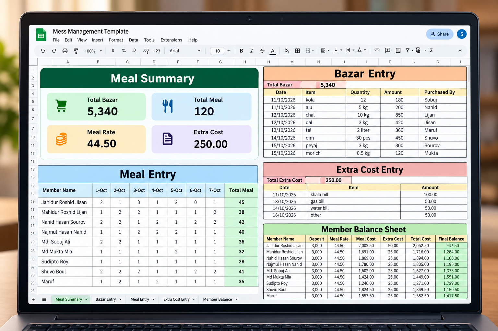

## 📊 Mess Management Spreadsheet Template

A ready-to-use spreadsheet for managing shared mess expenses and monthly meal accounts.

**Platform:** Google Sheets  
**Format:** Spreadsheet Template  
**Purpose:** Meal tracking, bazar expenses, extra costs, meal rate calculation, and member balances.
## 📸 Preview

### 📥 Get Your Own Copy

Create your own copy, add your mess members, and start tracking your accounts.

**Features**
- Daily meal entry
- Bazar expense tracking
- Extra cost management
- Automatic meal rate calculation
- Member deposit and balance tracking

**How to use:** Click the red button → Sign in to Google → Select **Make a copy** → Enter your own data.
